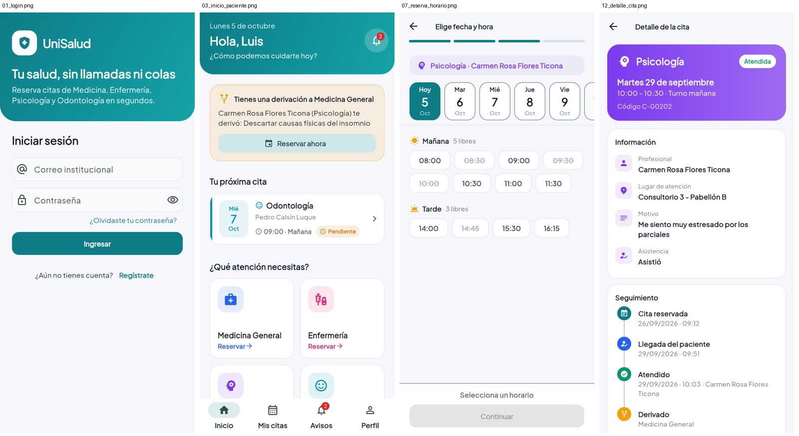
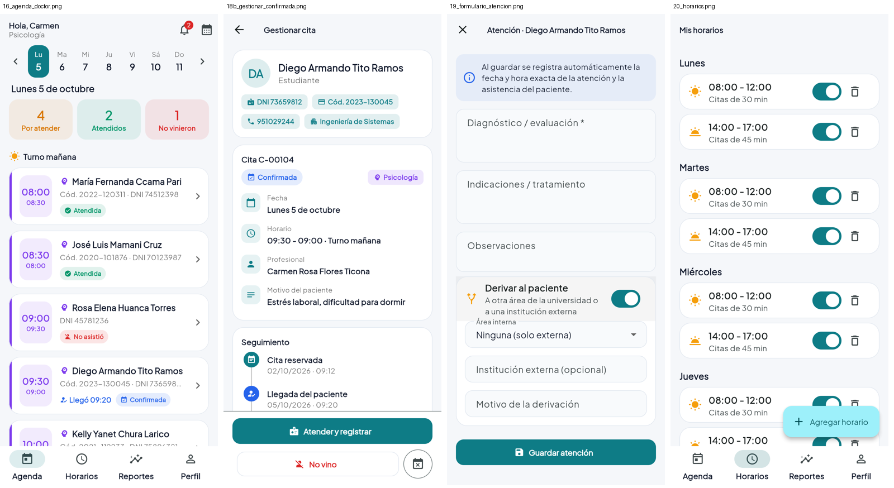
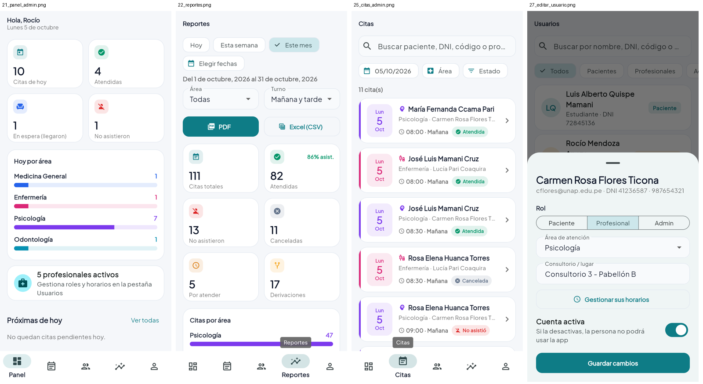

# UniSalud · App móvil de citas médicas universitarias

App para que estudiantes, docentes y personal **reserven citas desde el celular** en
**Medicina, Enfermería, Psicología y Odontología**, sin llamadas. Además registra
**cuándo y a qué hora fue atendido cada paciente, quién lo atendió, en qué turno
(mañana/tarde), si asistió o no y a dónde fue derivado**, y genera **reportes en PDF y Excel**.

- **App móvil:** Flutter (Android y iPhone)
- **Backend:** Supabase (base de datos PostgreSQL + inicio de sesión + seguridad por roles)

| Paciente | Profesional de salud | Administración |
|---|---|---|
|  |  |  |

---

## ¿Qué hace la app?

### 👤 Paciente (estudiante / docente / administrativo)
- Registro con DNI, código universitario, celular y facultad/escuela.
- **Reserva en 4 pasos:** área → profesional → fecha y hora → confirmar.
  Solo ve los días que atiende el profesional y los cupos libres (mañana y tarde).
- **Mis citas:** próximas e historial. Puede **cancelar** y liberar el cupo.
- **Seguimiento de cada cita:** cuándo reservó, cuándo llegó, cuándo fue atendido y por quién.
- Ve el diagnóstico/indicaciones y, si lo **derivaron**, reserva la cita en el área indicada con un toque.
- **Avisos** automáticos (reserva, confirmación, cancelación, atención, inasistencia).

### 🩺 Profesional de salud
- **Agenda del día** por turnos con contadores (por atender / atendidos / no vinieron).
- Por cada cita: **Confirmar**, **Registrar llegada**, **No vino**, **Cancelar** o **Atender y registrar**.
- Formulario de atención: diagnóstico, indicaciones, observaciones y **derivación**
  (a otra área de la universidad y/o a una institución externa, con motivo).
  La fecha y hora exacta de atención se guardan solas.
- Ve atenciones anteriores del paciente.
- Gestiona **sus horarios** (días, horas y duración de cada cita).
- **Mis reportes** de su propia productividad.

### 🏛️ Administración (Bienestar Universitario)
- **Panel del día:** citas, atendidas, pacientes en espera, inasistencias y carga por área.
- **Todas las citas** con filtros por fecha, área y estado, y buscador por paciente/DNI/código.
- **Usuarios:** convierte cuentas en *Profesional* (con área y consultorio) o *Admin*,
  desactiva cuentas y gestiona horarios de cualquier profesional.
- **Reportes** por periodo (hoy, semana, mes o rango): totales, % de asistencia, por área,
  por turno, por profesional, por tipo de paciente y **a dónde se derivó**.
  **Exporta a PDF y a Excel (CSV)** con el detalle completo de cada cita.

### 🔒 Seguridad
Toda la lógica crítica vive en la base de datos (no se puede "hackear" desde la app):
- Nadie puede reservar un horario ocupado ni fuera de la agenda del profesional.
- Un paciente solo ve sus citas; un profesional solo las suyas; el admin ve todo.
- Nadie puede auto-ascenderse a profesional o admin.

---

## 🧭 Guía paso a paso (desde cero)

> Tiempo estimado: 1 a 2 horas la primera vez. Las instrucciones son para **Windows**;
> en Mac/Linux los pasos son equivalentes.

### Paso 1 · Instalar las herramientas

1. **Git:** descarga e instala desde <https://git-scm.com/downloads> (todo "Siguiente").
2. **Visual Studio Code:** <https://code.visualstudio.com/>.
   Ábrelo → pestaña *Extensiones* (Ctrl+Shift+X) → instala **Flutter** (instala también Dart).
3. **Android Studio:** <https://developer.android.com/studio>.
   Ábrelo una vez y deja que descargue el *Android SDK*. Luego en
   *More Actions → SDK Manager → SDK Tools* marca **Android SDK Command-line Tools** → Apply.
4. **Flutter SDK:**
   - Lo más fácil: en VS Code presiona `Ctrl+Shift+P` → escribe **Flutter: New Project** →
     te dirá que falta el SDK → **Download SDK** → elige una carpeta *sin espacios ni tildes*
     (ej. `C:\src\flutter`) → acepta **Add SDK to PATH**.
   - O manual: <https://docs.flutter.dev/get-started/install/windows/mobile>.
5. Abre una terminal **nueva** (PowerShell) y ejecuta:
   ```bash
   flutter doctor
   flutter doctor --android-licenses   # acepta todo con "y"
   ```
   Debes ver ✓ en *Flutter*, *Android toolchain* y *VS Code*. (Lo de Chrome o Visual Studio no hace falta.)

> Esta app se probó con **Flutter 3.47** (canal *stable*). Si `flutter --version` muestra algo
> más antiguo, actualiza con `flutter upgrade`.

### Paso 2 · Descargar el proyecto

```bash
git clone https://github.com/JhansLazo/Anuska.git
cd Anuska
git checkout claude/medical-appointments-mobile-app-kmj5t3
cd unisalud_app
code .
```

### Paso 3 · Crear la base de datos en Supabase

1. Entra a <https://supabase.com> → **Start your project** → inicia sesión con GitHub.
2. **New project**: nombre `unisalud`, crea una contraseña segura de base de datos (guárdala),
   región **South America (São Paulo)** (la más cercana a Perú) → **Create new project**. Espera ~2 min.
3. Menú izquierdo → **SQL Editor** → **New query**:
   - Abre el archivo [`supabase/01_esquema.sql`](supabase/01_esquema.sql), copia **todo**, pégalo y presiona **Run**.
     Debe decir *Success. No rows returned*.
   - Nueva query con [`supabase/02_datos_iniciales.sql`](supabase/02_datos_iniciales.sql) → **Run**.
     Esto crea las 4 áreas: Medicina General, Enfermería, Psicología y Odontología.
4. **Correo de confirmación** (para pruebas):
   *Authentication → Sign In / Providers → Email* → desactiva **Confirm email** → *Save*.
   Así puedes registrarte y entrar de inmediato. En producción puedes volver a activarlo
   (el usuario recibirá un enlace para confirmar antes de entrar).
5. **Zona horaria:** el script usa `America/Lima`. Si tu universidad está en otro país,
   cambia ese texto en la función `ahora_local()` al inicio de `01_esquema.sql` antes de ejecutarlo.

### Paso 4 · Conectar la app con Supabase

1. En Supabase: **Project Settings → API Keys**. Copia la **Publishable key** (`sb_publishable_...`).
   Si tu proyecto muestra la pestaña *Legacy*, sirve también la clave **anon public**.
2. En **Project Settings → Data API** copia la **Project URL** (`https://xxxx.supabase.co`).
3. Abre `lib/core/config/supabase_config.dart` y reemplaza:
   ```dart
   defaultValue: 'https://TU-PROYECTO.supabase.co',   // ← tu Project URL
   defaultValue: 'TU-PUBLISHABLE-KEY',                // ← tu Publishable key
   ```
   ⚠️ **Nunca** pongas la *secret key* ni la *service_role*: esas dan acceso total.

### Paso 5 · Ejecutar la app en tu celular

1. En tu Android: *Ajustes → Acerca del teléfono* → toca 7 veces **Número de compilación**
   → vuelve a *Ajustes → Sistema → Opciones de desarrollador* → activa **Depuración USB**.
2. Conecta el celular por USB y acepta el permiso que aparece.
3. En la terminal (dentro de `unisalud_app`):
   ```bash
   flutter pub get
   flutter devices    # debe aparecer tu celular
   flutter run
   ```
   La primera compilación tarda varios minutos. ¿Sin celular? En Android Studio:
   *Device Manager → Create device* (ej. Pixel 8) ▶ y luego `flutter run`.

### Paso 6 · Crear los usuarios iniciales

1. Desde la app, **regístrate** con tu correo (será el administrador).
2. En Supabase → **SQL Editor**, conviértete en admin:
   ```sql
   update public.perfiles set rol = 'admin' where email = 'tu-correo@universidad.edu.pe';
   ```
3. Cierra sesión y vuelve a entrar: verás el **panel de administración**.
4. Pide a cada profesional (médico, enfermera, psicólogo, odontólogo) que se registre en la app.
   Luego, como admin: **Usuarios** → toca su nombre → rol **Profesional** → elige su **área** y
   **consultorio** → *Guardar*.
5. Cada profesional entra a **Horarios → Agregar horario** (ej. lunes a viernes, 08:00–12:00,
   citas de 30 min; y 14:00–17:00). ¡Listo! Ya se pueden reservar citas.

### Paso 7 · Probar el flujo completo

1. Con una cuenta de estudiante: *Inicio → Psicología → profesional → fecha → hora → Confirmar*.
2. Con la cuenta del profesional: *Agenda* → toca la cita → **Llegó** → **Atender y registrar** →
   escribe diagnóstico, activa *Derivar al paciente* → elige *Medicina General* → *Guardar*.
3. Con el estudiante: verás el aviso y el botón **Reservar ahora** para la derivación.
4. Con el admin: **Reportes** → *Este mes* → **PDF** o **Excel (CSV)**.

### Paso 8 · Generar el instalador (APK) para compartir

```bash
flutter build apk --release
```
El archivo queda en `build/app/outputs/flutter-apk/app-release.apk`. Envíalo por WhatsApp/Drive
e instálalo (Android pedirá permitir "orígenes desconocidos").
Para publicar en Play Store se necesita firmar la app:
<https://docs.flutter.dev/deployment/android>.

---

## 🗂️ Estructura del proyecto

```
unisalud_app/
├── supabase/
│   ├── 01_esquema.sql          # tablas, seguridad (RLS), funciones, notificaciones, vista de reportes
│   └── 02_datos_iniciales.sql  # áreas de atención + cómo crear admin/profesionales
├── lib/
│   ├── main.dart
│   ├── core/
│   │   ├── config/             # credenciales de Supabase
│   │   ├── theme/              # colores y tema (claro/oscuro)
│   │   ├── utils/              # formatos de fecha/hora y mensajes de error en español
│   │   └── widgets/            # componentes reutilizables (tarjetas, chips, KPIs...)
│   ├── data/
│   │   ├── models/             # Perfil, Cita, Especialidad, Horario, Notificación
│   │   └── services/           # acceso a Supabase (sesión, citas, catálogo, usuarios, avisos)
│   └── features/
│       ├── auth/               # login, registro y redirección por rol
│       ├── paciente/           # inicio, reservar, mis citas, detalle
│       ├── doctor/             # agenda, gestionar/atender cita, horarios
│       ├── admin/              # panel, citas, usuarios
│       └── comun/              # perfil, avisos, reportes y exportación PDF/CSV
└── test/                       # pruebas automáticas
```

### Modelo de datos

| Tabla | Para qué sirve |
|---|---|
| `especialidades` | Las áreas: medicina, enfermería, psicología, odontología (puedes agregar más). |
| `perfiles` | Datos de cada usuario y su **rol**: paciente, doctor (profesional) o admin. |
| `horarios_doctor` | Días y horas en que atiende cada profesional y duración de cada cita. |
| `citas` | Cada reserva: fecha, hora, **turno**, estado, **asistió**, **hora de llegada**, **atendida_en**, diagnóstico, **derivado_a** / derivación externa, cancelación. |
| `notificaciones` | Avisos generados automáticamente por la base de datos. |
| `v_citas` (vista) | Une todo con nombres legibles; la usan las listas y los reportes. |

Estados de una cita: `pendiente → confirmada → atendida` o `no_asistio` o `cancelada`.

---

## 🎨 Diseño (UI/UX)

El diseño sigue las pautas de **UI/UX Pro Max** para apps de salud:
paleta calmada (verde azulado clínico) con un color propio por área, tipografía
*Plus Jakarta Sans*, botones grandes (≥ 48 px) fáciles de tocar, contraste accesible,
estados vacíos y de error con explicación y botón de acción, un solo objetivo por pantalla,
modo oscuro automático e íconos Material (sin emojis).

Si quieres que Claude Code siga usando esa skill al hacer cambios de diseño, instálala en tu
computadora (la versión instalada no estaba disponible en esta sesión; las pautas se aplicaron manualmente):

```bash
npm install -g ui-ux-pro-max-cli
cd unisalud_app
uipro init --ai claude
```
O dentro de Claude Code:
```
/plugin marketplace add nextlevelbuilder/ui-ux-pro-max-skill
/plugin install ui-ux-pro-max@ui-ux-pro-max-skill
```

---

## ❓ Problemas frecuentes

| Problema | Solución |
|---|---|
| La app dice **"Falta conectar Supabase"** | No pegaste la URL/clave en `supabase_config.dart` (Paso 4). |
| **"No encontramos tu perfil"** | Te registraste antes de ejecutar `01_esquema.sql`. Ejecuta el script, borra el usuario en *Authentication → Users* y regístrate de nuevo. |
| **"Confirma tu correo antes de ingresar"** | Desactiva *Confirm email* (Paso 3.4) o abre el enlace del correo. |
| El profesional dice **"Sin horarios publicados"** | Ese profesional debe agregar horarios en la pestaña *Horarios*. |
| No aparece un área al reservar | Debe existir al menos un profesional de esa área con rol *Profesional*. |
| `flutter doctor` marca error en Android licenses | Ejecuta `flutter doctor --android-licenses` y acepta con `y`. |
| No detecta el celular | Revisa el cable (que transfiera datos), la *Depuración USB* y acepta el permiso en el celular. |

## 🚀 Ideas para seguir mejorando
- Recordatorios push el día anterior (Firebase Cloud Messaging + Supabase Edge Functions).
- Bloqueo de días feriados o vacaciones del profesional.
- Historia clínica completa por paciente y adjuntar archivos (Supabase Storage).
- Encuesta de satisfacción después de cada atención.
